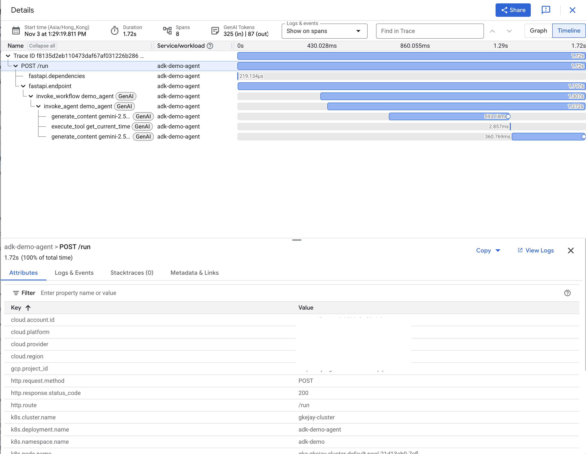
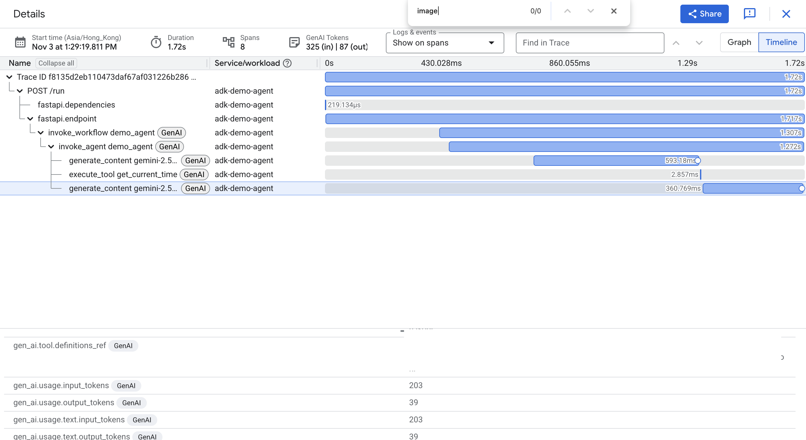
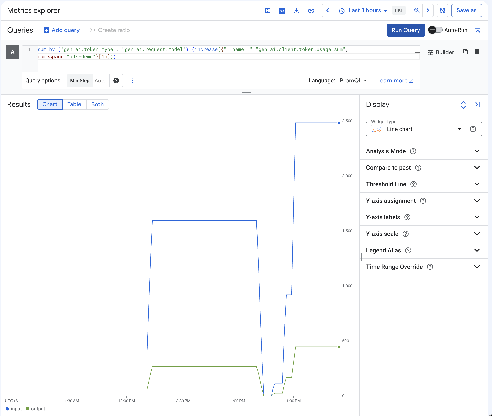

# GKE Managed OpenTelemetry for ADK agent

Managed OpenTelemetry for GKE went GA on [October 29, 2026](https://docs.cloud.google.com/kubernetes-engine/docs/release-notes#October_29_2026) for clusters on 1.37.1-gke.1697000 or later. Google runs the OpenTelemetry Collector for you: your workloads send OpenTelemetry Protocol (OTLP) traces, metrics, and logs to a collector in the `gke-managed-otel` namespace, and you deploy no collector yourself.

This repo runs the default ADK FastAPI app, which ships a chat web UI, and demos two GA features:

- OTLP traces, metrics, and logs to the managed collector, configured by the `Instrumentation` custom resource (GenAI events land under the `gen_ai.client.inference.operation.details` log name)
- Multimodal prompt/response capture to Cloud Storage (`promptsResponses`)

## Architecture

```
┌──────────────────────────── GKE cluster (1.37.1-gke.1697000+) ───────────────┐
│  ns: adk-demo                            ns: gke-managed-otel (Google-managed)│
│  ┌──────────────────────┐   OTLP/HTTP    ┌─────────────────────────┐          │
│  │ ADK agent (FastAPI/  │ ─────:4318───▶ │ Managed OTel Collector  │          │
│  │ adk web, Gemini via  │  (gRPC :4317   │ (autoscaled, per-signal │          │
│  │ Vertex AI)           │   also avail)  │  queueing)              │          │
│  └──────────▲───────────┘                └───────────┬─────────────┘          │
│             │ env vars injected by                   │                        │
│  ┌──────────┴───────────┐                            │                        │
│  │ Instrumentation CR   │                            │                        │
│  │ (telemetry.googleapis│                            │                        │
│  │  .com/v1alpha1)      │                            │                        │
│  └──────────────────────┘                            │                        │
└──────────────────────────────────────────────────────┼────────────────────────┘
                                                       ▼
                               telemetry.googleapis.com (Cloud Telemetry API)
                                 ├─▶ Cloud Trace   (invoke_agent / generate_content spans)
                                 ├─▶ Cloud Monitoring (OTLP metrics)
                                 └─▶ Cloud Logging (log name defaults to `otlp`)

ADK agent (GenAI upload hook, direct from app, bypasses the collector)──▶ GCS bucket (JSONL prompts/responses)
```

> [!NOTE]
> The app uploads prompts and responses to the bucket itself (hence the bucket
> permission on the *workload* SA); the collector only carries telemetry that
> references the uploaded objects.

## Run locally

```bash
cd app
cp .env.example .env   # set GOOGLE_CLOUD_PROJECT; needs gcloud ADC for Vertex AI
uv venv && uv pip install -r pyproject.toml
.venv/bin/python main.py
```

Open http://localhost:8080, chat, and attach an image with the paperclip. If `OTEL_EXPORTER_OTLP_ENDPOINT` is unset, the app skips telemetry export.

## Deploy to GKE

All steps below read `PROJECT_ID`, `LOCATION`, `AR_REPO`, and `BUCKET_NAME` from `.env`, so fill that in first and export it into your shell:

```bash
cp .env.example .env && $EDITOR .env
set -a; . ./.env; set +a
```

### 1. Create the Artifact Registry repo and the GCS bucket

Skip whichever already exists. A dedicated bucket keeps the `objectUser` grant in step 2 scoped to demo data; the Cleanup section deletes only the `adk-demo/` prefix.

```bash
gcloud artifacts repositories create "$AR_REPO" \
  --repository-format=docker --location="$LOCATION"

gcloud storage buckets create "gs://$BUCKET_NAME" \
  --location="$LOCATION" --uniform-bucket-level-access
```

### 2. Create the workload Google service account and IAM bindings

The Pod runs as the Kubernetes SA `adk-demo-sa` in namespace `adk-demo`, which `k8s/deployment.yaml` annotates with `iam.gke.io/gcp-service-account: adk-demo-gsa@${PROJECT_ID}.iam.gserviceaccount.com`.
That GSA must exist, hold the roles below, and allow the KSA to impersonate it. Otherwise Vertex AI calls, telemetry export, and GCS uploads all fail with permission errors.

```bash
GSA="adk-demo-gsa@${PROJECT_ID}.iam.gserviceaccount.com"

gcloud iam service-accounts create adk-demo-gsa \
  --display-name="ADK demo workload (GKE Workload Identity)"

# Vertex AI (Gemini) + the three telemetry signals via telemetry.googleapis.com
for role in roles/aiplatform.user roles/telemetry.tracesWriter \
            roles/logging.logWriter roles/monitoring.metricWriter; do
  gcloud projects add-iam-policy-binding "$PROJECT_ID" \
    --member="serviceAccount:$GSA" --role="$role" --condition=None
done

# Multimodal prompt/response uploads go straight from the app to the bucket.
# objectUser: the upload hook checks whether the
# content-addressed system_instruction/tool.definitions files already exist,
# which needs storage.objects.get + list. 
gcloud storage buckets add-iam-policy-binding "gs://$BUCKET_NAME" \
  --member="serviceAccount:$GSA" --role=roles/storage.objectUser

# Workload Identity: let the KSA adk-demo/adk-demo-sa act as the GSA
gcloud iam service-accounts add-iam-policy-binding "$GSA" \
  --role=roles/iam.workloadIdentityUser \
  --member="serviceAccount:${PROJECT_ID}.svc.id.goog[adk-demo/adk-demo-sa]"
```

> [!NOTE]
> `gcloud storage buckets add-iam-policy-binding` grants at the bucket level,
> so the GSA can write only to this bucket.

### 3. Create the cluster

Managed OTel GA needs GKE 1.37.1-gke.1697000 or later. Check which versions the RAPID channel offers in your region, then create an Autopilot cluster with the managed collector and instrumentation components enabled:

```bash
gcloud container get-server-config --location="$LOCATION" \
  --format="yaml(channels)" | grep -A3 RAPID

# --cluster-version: 1.37.1-gke.1697000 or any newer version from the list above
gcloud container clusters create-auto adk-otel-demo \
  --location="$LOCATION" --release-channel=rapid \
  --cluster-version=1.37.1-gke.1697000 \
  --managed-otel-scope=COLLECTION_AND_INSTRUMENTATION_COMPONENTS

gcloud container clusters get-credentials adk-otel-demo --location="$LOCATION"
kubectl get crd instrumentations.telemetry.googleapis.com   # must exist
```

> [!NOTE]
> The screenshots below come from a Standard cluster. On Standard, pass the same
> `--release-channel`, `--cluster-version`, and `--managed-otel-scope` flags to
> `gcloud container clusters create`, plus `--workload-pool="${PROJECT_ID}.svc.id.goog"`.
> Autopilot enables Workload Identity Federation by default.

### 4. Build and push the image

```bash
./build.sh
```

[`build.sh`](build.sh) reads `.env` and runs Cloud Build with `app/cloudbuild.yaml`, pushing `${LOCATION}-docker.pkg.dev/${PROJECT_ID}/${AR_REPO}/adk-demo-agent:latest`, the same path `k8s/deployment.yaml` references. Like `render.sh`, it exits and names the missing key if `.env` is incomplete. [`app/.gcloudignore`](app/.gcloudignore) keeps a local `.venv/` and `.env` out of the upload.

The image installs from the version ranges in `app/pyproject.toml`. There is no lock file, so two builds weeks apart can resolve different `google-adk` versions; pin exact versions there if you need reproducible images.

### 5. Render, apply, and verify injection

```bash
./render.sh | kubectl apply -f -

# The Instrumentation CR only injects env vars into Pods created *after* the
# CR exists, so always restart once after the first apply (and after any CR
# change), then confirm the OTEL_* vars are present:
kubectl -n adk-demo rollout restart deploy/adk-demo-agent
kubectl -n adk-demo rollout status  deploy/adk-demo-agent
kubectl -n adk-demo exec deploy/adk-demo-agent -- env | grep ^OTEL_ | sort
```

Expected output (values vary):

```
OTEL_EXPORTER_OTLP_ENDPOINT=http://opentelemetry-collector.gke-managed-otel.svc.cluster.local:4318
OTEL_INSTRUMENTATION_GENAI_CAPTURE_MESSAGE_CONTENT=NO_CONTENT
OTEL_INSTRUMENTATION_GENAI_COMPLETION_HOOK=upload
OTEL_INSTRUMENTATION_GENAI_EMIT_EVENT=true
OTEL_INSTRUMENTATION_GENAI_UPLOAD_BASE_PATH=gs://<BUCKET_NAME>/adk-demo
OTEL_INSTRUMENTATION_GENAI_UPLOAD_FORMAT=jsonl
OTEL_METRIC_EXPORT_INTERVAL=30000
OTEL_SEMCONV_STABILITY_OPT_IN=gen_ai_latest_experimental
OTEL_SERVICE_NAME=adk-demo-agent
```

If you only see `OTEL_INSTRUMENTATION_GENAI_CAPTURE_MESSAGE_CONTENT`, `OTEL_INSTRUMENTATION_GENAI_EMIT_EVENT`, and `OTEL_SERVICE_NAME` (the three set in `deployment.yaml`), injection did not happen: nothing is exported and nothing is uploaded. Re-run the restart.

### 6. Test

```bash
kubectl port-forward -n adk-demo svc/adk-demo-agent 8080:80
```

Open http://localhost:8080. If the Pod is `CrashLoopBackOff` or requests fail with `403`, re-check step 2: `kubectl -n adk-demo describe sa adk-demo-sa` should show the annotation, and the GSA must have the five roles plus the `workloadIdentityUser` binding.

1. Ask a text question → trace with `invoke_agent` and `generate_content` spans.
2. Ask "what time is it?" → adds an `execute_tool get_current_time` span.
3. Attach an image and ask "what's in this image?" → `*_inputs.jsonl` / `*_outputs.jsonl` objects land in `gs://<BUCKET_NAME>/adk-demo/`, and the matching log entry carries `gen_ai.input.messages_ref` pointing at them.
4. Open the trace, the GenAI log entry, the token-usage chart, and the JSONL object side by side (see the next section for where each one lives).

## View telemetry in the Google Cloud console

Allow about a minute after a chat turn for data to appear (metrics export every 30 s; the first trace in a project can take a few minutes while Cloud Trace warms up).

### Traces: Trace Explorer

Console: **Observability → Trace → Trace Explorer**
(`https://console.cloud.google.com/traces/explorer?project=<PROJECT_ID>`).

- Add filter **Service name** = `adk-demo-agent` (from `OTEL_SERVICE_NAME`).
- Or filter **Span name** = `generate_content gemini-2.5-flash` to find LLM
  calls, or `invoke_agent demo_agent` for whole turns.
- Click a trace. The span tree for one turn looks like:



- On a `generate_content` span, the **Logs & events** tab shows the GenAI
  event with the prompt and response; the **Attributes** tab shows
  `gen_ai.usage.input_tokens`, `gen_ai.usage.output_tokens`,
  `gen_ai.request.model`, `gen_ai.provider.name=vertex_ai`.



> [!NOTE]
> ADK 2.x names spans `invoke_agent` / `generate_content` / `execute_tool`
> (GenAI semantic conventions). There is no `call_llm` span.

### Metrics: Metrics Explorer with PromQL

Console: **Observability → Monitoring → Metrics Explorer**
(`https://console.cloud.google.com/monitoring/metrics-explorer?project=<PROJECT_ID>`),
then click **< > PromQL** (or **MQL/PromQL** toggle) and paste a query.

OTLP metrics arrive as Prometheus-style metrics with their **original dotted
names and labels**, so the selector must use the quoted UTF-8 form
(`{"__name__"="…"}`), not an underscored name like `gen_ai_client_token_usage`.

| What                                   | PromQL |
|----------------------------------------|--------|
| Tokens per hour, by type and model     | `sum by ("gen_ai.token.type", "gen_ai.request.model") (increase({"__name__"="gen_ai.client.token.usage_sum", namespace="adk-demo"}[1h]))` |
| LLM calls per hour                     | `sum by ("gen_ai.operation.name") (increase({"__name__"="gen_ai.client.operation.duration_count", namespace="adk-demo"}[1h]))` |
| p95 LLM latency (seconds)              | `histogram_quantile(0.95, sum by (le) (rate({"__name__"="gen_ai.client.operation.duration_bucket", namespace="adk-demo"}[1h])))` |
| Tool calls per hour, by tool           | `sum by ("gen_ai.tool.name") (increase({"__name__"="gen_ai.execute_tool.duration_count", namespace="adk-demo"}[1h]))` |



Other metrics the agent emits: `gen_ai.invoke_agent.duration`,
`gen_ai.invoke_agent.inference_calls`, `gen_ai.invoke_agent.tool_calls`,
`gen_ai.invoke_workflow.duration` (all histograms; append `_sum`, `_count`, or
`_bucket`). In the classic (non-PromQL) picker they are listed under the
**Prometheus Target** resource as `prometheus.googleapis.com/gen_ai.…/histogram`.

### Logs: Logs Explorer

Console: **Observability → Logging → Logs Explorer**
(`https://console.cloud.google.com/logs/query?project=<PROJECT_ID>`). Paste:

```
resource.type="k8s_pod"
resource.labels.namespace_name="adk-demo"
logName="projects/<PROJECT_ID>/logs/gen_ai.client.inference.operation.details"
```

Each entry is one LLM call. Expand it and look under **labels**:
`gen_ai.input.messages_ref`, `gen_ai.output.messages_ref`,
`gen_ai.system_instructions_ref`, `gen_ai.tool.definitions_ref` with the
`gs://…jsonl` object paths, plus `gen_ai.conversation.id` (ADK session),
`gcp.vertex.agent.invocation_id` (one user turn), token counts, and model. The
entry's `trace` field links to the trace in Trace Explorer.

> [!IMPORTANT]
> The Deployment sets `OTEL_INSTRUMENTATION_GENAI_CAPTURE_MESSAGE_CONTENT=NO_CONTENT`
> plus `OTEL_INSTRUMENTATION_GENAI_EMIT_EVENT=true` on purpose. The content
> lives in GCS; the log entry only carries the `_ref` pointers. If you switch to
> `EVENT_ONLY`, the SDK also inlines the full messages, base64 images included,
> in the log attributes, and Cloud Logging **drops the entire entry** when any
> attribute exceeds 64 KB; the collector logs
> `Publish to Cloud Logging failed: 'LogRecord.Attributes[N].value' is too large`.
> A 170 KB image triggers this. Text-only demos work either way; multimodal
> demos need `NO_CONTENT`.

> [!NOTE]
> GenAI events use their event name as the log name, so `logName="…/otlp"`
> misses them; `otlp` is the default only for OTLP log records with no event
> name. Filter on `resource.type="k8s_pod"`; `k8s_container` holds the
> container's stdout.

### Multimodal prompts and responses: Cloud Storage

```bash
gcloud storage ls -l "gs://$BUCKET_NAME/adk-demo/"
gcloud storage cat "gs://$BUCKET_NAME/adk-demo/<id>_inputs.jsonl" | head -c 2000
```

Per LLM call you get `<uuid>_inputs.jsonl` and `<uuid>_outputs.jsonl` (one JSON message per line; image parts are `{"type":"blob","modality":"image", "mime_type":"image/png","content":"<base64>"}`), plus content-addressed `<sha256>_system_instruction.jsonl` and `<sha256>_tool.definitions.jsonl` that are written once and reused.

## Cleanup

```bash
set -a; . ./.env; set +a
GSA="adk-demo-gsa@${PROJECT_ID}.iam.gserviceaccount.com"

kubectl delete ns adk-demo
gcloud container clusters delete adk-otel-demo --location="$LOCATION"

# Demo data only; the bucket itself stays.
gcloud storage rm -r "gs://$BUCKET_NAME/adk-demo"
gcloud storage buckets remove-iam-policy-binding "gs://$BUCKET_NAME" \
  --member="serviceAccount:$GSA" --role=roles/storage.objectUser
# Created the bucket for this demo alone? Delete it instead:
#   gcloud storage rm -r "gs://$BUCKET_NAME"

gcloud artifacts repositories delete "$AR_REPO" --location="$LOCATION"
for role in roles/aiplatform.user roles/telemetry.tracesWriter \
            roles/logging.logWriter roles/monitoring.metricWriter; do
  gcloud projects remove-iam-policy-binding "$PROJECT_ID" \
    --member="serviceAccount:$GSA" --role="$role" --condition=None
done
gcloud iam service-accounts delete "$GSA"
```
